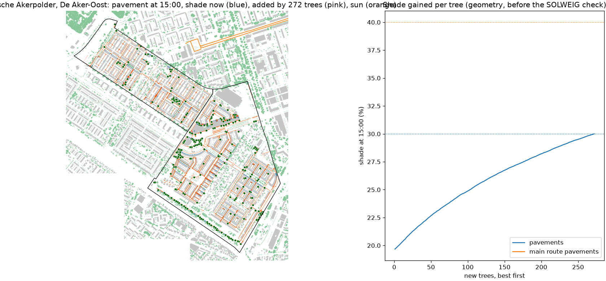

# New trees for Middelveldsche Akerpolder, De Aker-Oost

272 new trees, each 12 m tall with an 8 m crown, chosen one at a time where they add the most shade on 104848 m2 of pavement (0 m2 along the main walking routes), from 13185 possible spots on public pavement and green at least 4 m from facades and 5 m from existing crowns. Cables and pipes are not in open data, so every spot needs the city's check. The full model (SOLWEIG and PET, 2019-07-25) is then run with and without the trees.

| On the neighbourhood's pavements | Now | With the trees | Search estimate |
|---|---|---|---|
| Pavement shade at 11:00 | 26% | 34% |  |
| Pavement shade at 15:00 | 21% | 32% | 30% |
| Pavement shade at 17:00 | 35% | 45% |  |
| Mean Tmrt on pavements at 15:00 | 59.5 C | 56.1 C |  |
| Mean afternoon PET on pavements | 45.9 C | 44.6 C |  |
| Pavement above 41 C PET | 84% | 74% |  |

Where the new crowns shade the pavement (27943 m2), Tmrt at 15:00 drops by 12 C and afternoon PET by 5.0 C on average.

