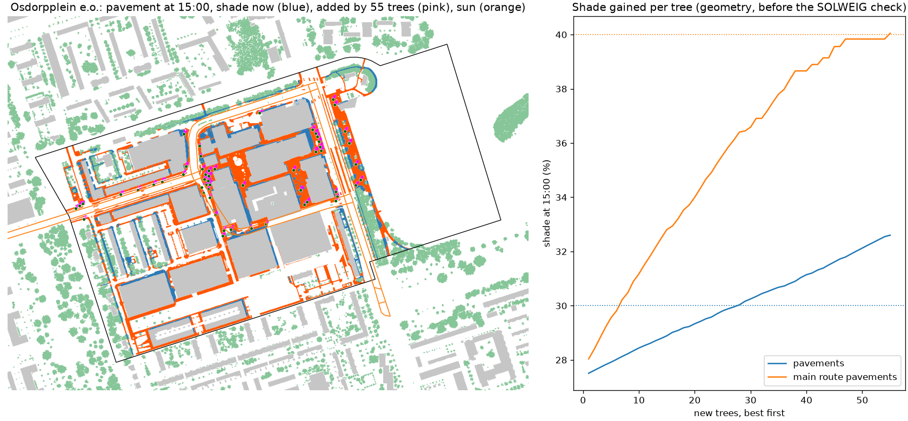

# New trees for Osdorpplein e.o.

55 new trees, each 12 m tall with an 8 m crown, chosen one at a time where they add the most shade on 65067 m2 of pavement (17017 m2 along the main walking routes), from 2996 possible spots on public pavement and green at least 4 m from facades and 5 m from existing crowns. Cables and pipes are not in open data, so every spot needs the city's check. The full model (SOLWEIG and PET, 2019-07-25) is then run with and without the trees.

| On the neighbourhood's pavements | Now | With the trees | Search estimate |
|---|---|---|---|
| Pavement shade at 11:00 | 32% | 37% |  |
| Pavement shade at 15:00 | 30% | 35% | 33% |
| Pavement shade at 17:00 | 33% | 38% |  |
| Main route pavement shade at 15:00 | 30% | 43% | 40% |
| Mean Tmrt on pavements at 15:00 | 58.7 C | 56.6 C |  |
| Mean afternoon PET on pavements | 46.0 C | 45.1 C |  |
| Pavement above 41 C PET | 79% | 74% |  |

Where the new crowns shade the pavement (12092 m2), Tmrt at 15:00 drops by 10 C and afternoon PET by 4.4 C on average.

